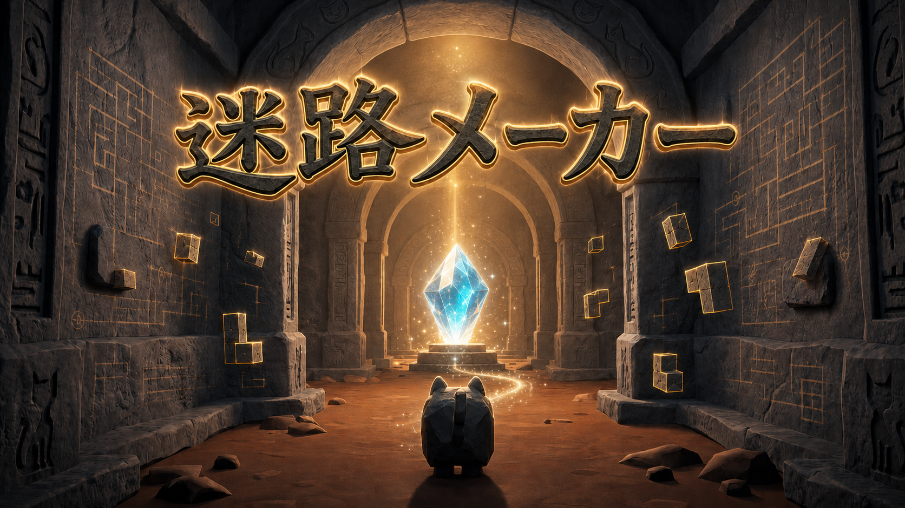

# 迷路メーカー

**迷路を遊ぶ。迷路を作る。**  
C++ と DxLib で制作した、3D迷路ゲームです。プレイヤーは迷路を探索してゴールを目指し、作成したマップをそのままゲーム内でプレイできます。

## 担当した機能

2人で制作し、以下の機能を担当しました。

- シーン管理システム
- プレイヤー・カメラ制御
- UIシステム
- サウンド・画像情報の管理
- 入力管理システム、キーコンフィグ
- 敵の管理、敵AI

## 技術的な工夫

### 入力管理とキーコンフィグ

キーボードやゲームパッドの入力を、ゲーム内では「移動」「ジャンプ」「決定」などのActionとして扱います。入力デバイスごとの処理をまとめ、ゲーム側の動作と入力機器を切り離しました。

また、ボタンを押した瞬間の入力と、押している間の入力を区別しています。キーやゲームパッドの割り当て、カメラ感度や反転設定はゲーム内で変更でき、設定はJSONファイルに保存されます。

### プレイヤーとカメラ

プレイヤーの移動・ジャンプ・ダッシュを実装し、マップとの衝突判定と組み合わせています。カメラはプレイヤーを追従し、壁などの地形に埋まらないよう衝突を考慮して位置を調整します。視点操作はマウス、矢印キー、ゲームパッドに対応しています。

### 敵AI

敵は設定されたポイントを巡回し、プレイヤーが一定範囲に入ると追跡へ切り替わります。追跡経路の探索には幅優先探索（BFS）を使い、経路を一定間隔で更新します。プレイヤーと別の階層にいる敵の更新を抑え、不要な処理を減らしています。

### UI管理

ボタンやスライダーなどのUI要素を共通の `UIManager` で管理しています。マウス操作に加えて、キーボードやゲームパッドの方向入力でフォーカスを移動できます。UIのグループを使って、上下方向と左右方向で選択対象を切り替えています。

### シーン管理と遷移演出

タイトル、ゲーム、エディタ、リザルトなどのシーンを `SceneManager` で管理しています。フェードやスライドの演出中に切り替えタイミングを制御し、遷移が終わってから新しいシーンを初期化する構成です。

### サウンドと画像情報

サウンドは名前で読み込み・再生できる `SoundManager` を実装しました。BGMはループ再生、効果音は重ねて再生でき、マスター音量・BGM音量・効果音音量を個別に設定できます。

画像はパスとサイズを `ImagePath` にまとめ、使用箇所から画像情報を参照できるようにしています。

## 作品情報

| 項目 | 内容 |
| --- | --- |
| 制作人数 | 2人 |
| 制作時間 | 約300時間 |
| 開発環境 | Visual Studio 2022 |
| 使用技術 | C++、DxLib |

## ゲームモード

### 遊ぶモード

迷路を探索し、敵の巡回や追跡を避けながらゴールを目指します。

### 作るモード

マップエディタで作成した迷路を、ゲームモードからテストプレイできます。

## 操作方法

以下はデフォルト設定です。キーコンフィグからキーボードとゲームパッドの割り当てを変更できます。

| 操作 | キーボード | ゲームパッド |
| --- | --- | --- |
| 移動 | WASD | 左スティック |
| 視点操作 | マウス／矢印キー | 右スティック |
| ジャンプ | Space | Aボタン |
| ダッシュ | 左Shift | Rボタン |
| 決定 | Enter | Bボタン |
| ポーズ | Esc | STARTボタン |

## ソースコードの見どころ

| ファイル | 役割 |
| --- | --- |
| [`Input.cpp`](Input.cpp) | キーボード・ゲームパッド入力をActionとして扱い、各入力軸をまとめる |
| [`Option.cpp`](Option.cpp) | キー設定や音量、カメラ設定の読み込み・保存 |
| [`Character.cpp`](Character.cpp) | プレイヤー、カメラ、敵の動作と敵AI |
| [`UIManager.cpp`](UIManager.cpp) | UIのフォーカス移動、入力、更新、描画 |
| [`SceneManager.cpp`](SceneManager.cpp) | シーンの切り替えと遷移タイミングの管理 |
| [`Sound.cpp`](Sound.cpp) | BGM・効果音の再生と音量設定 |
| [`Image.h`](Image.h) | 画像パスとサイズの定義 |

## 今後の改善点

- ソースファイルの細分化
- UIと操作性の改善
- プレイヤー操作と敵AIの調整
